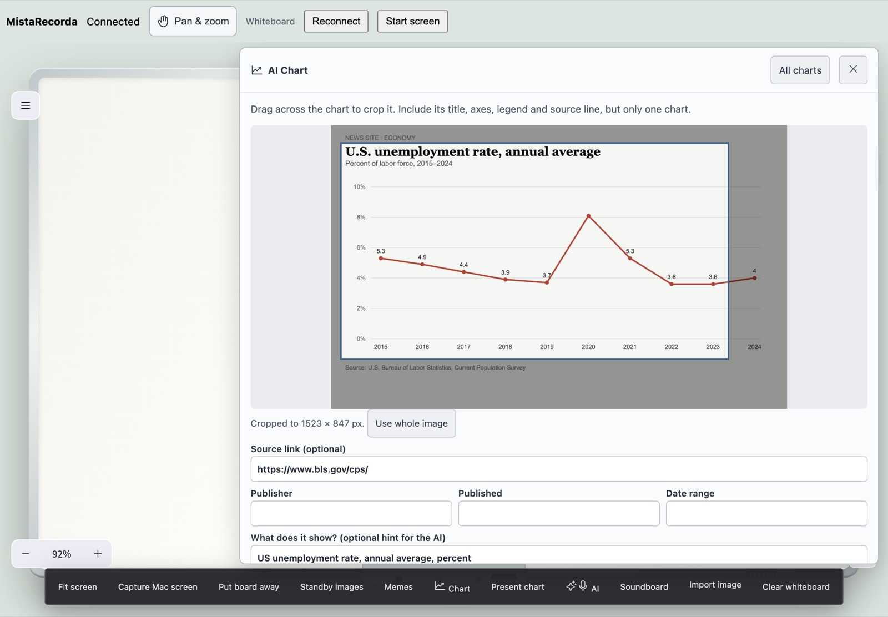
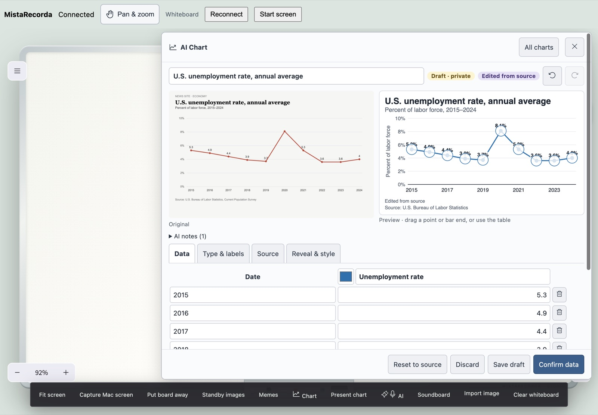
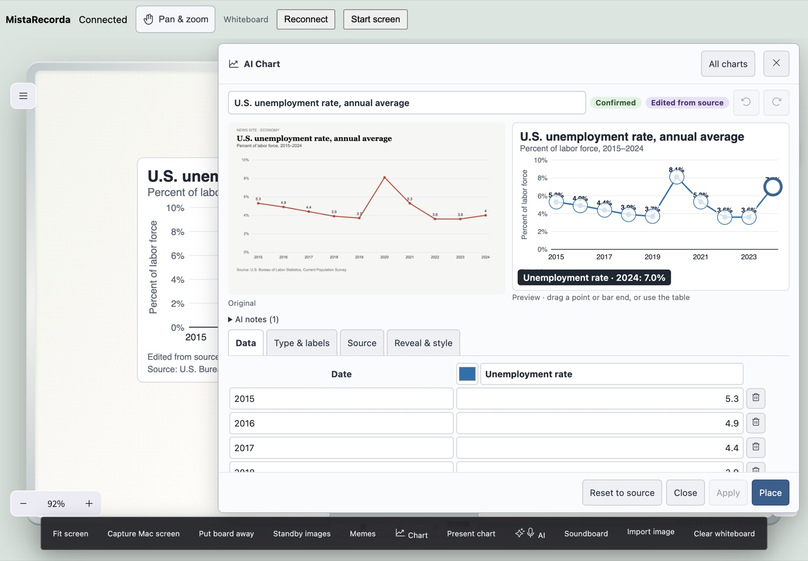
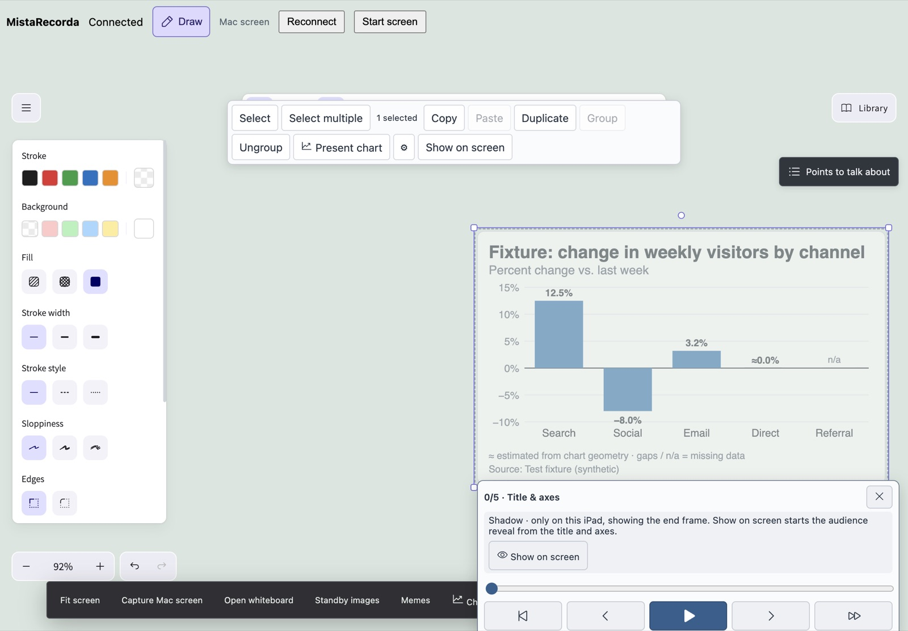
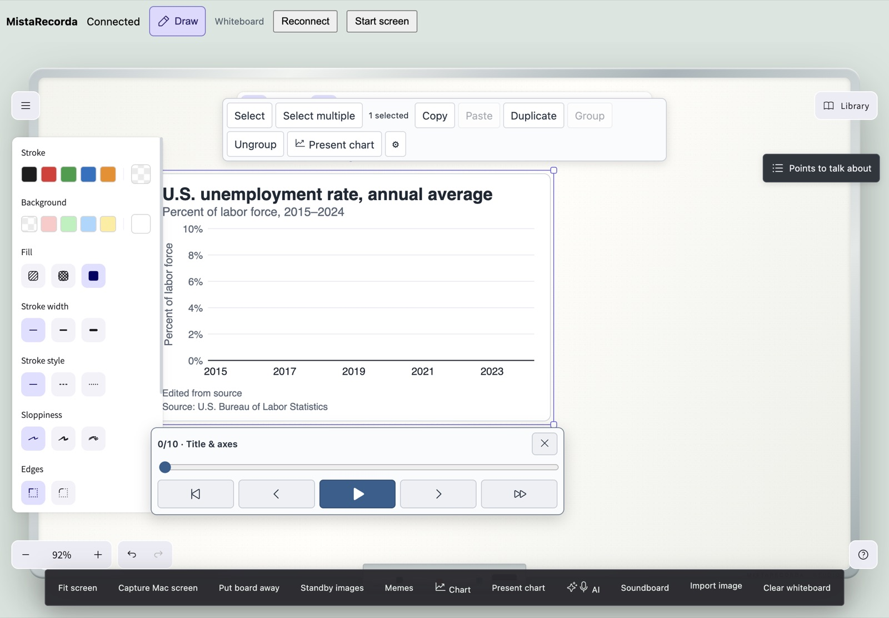
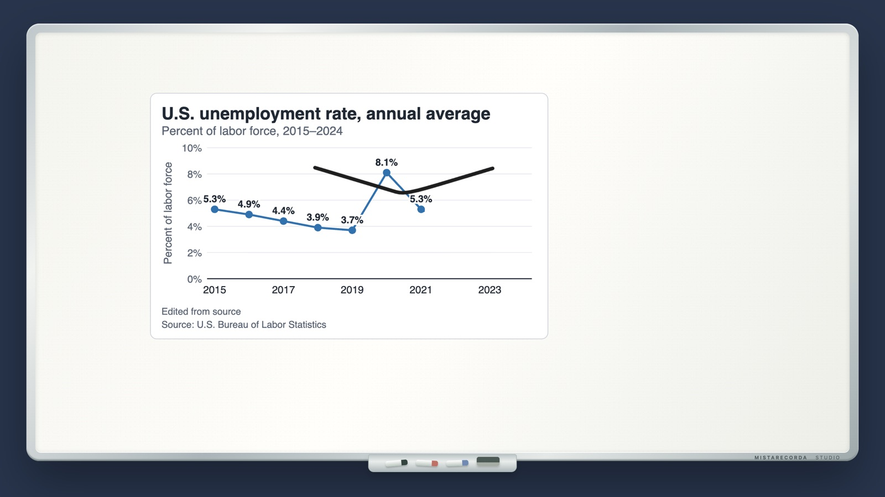
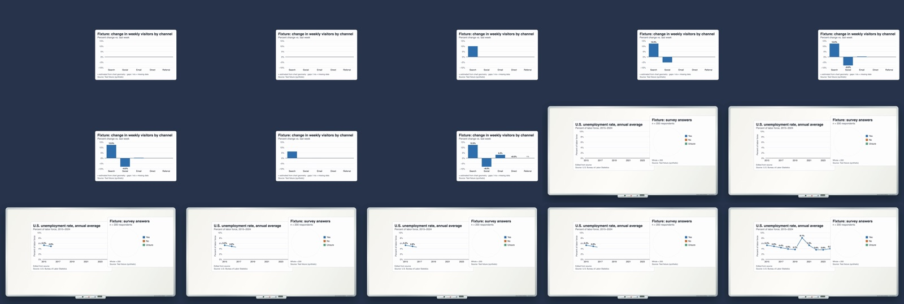
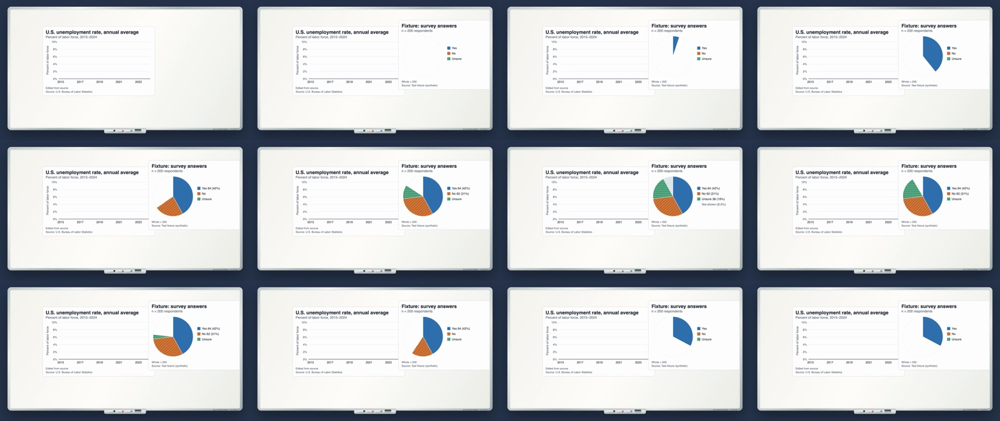
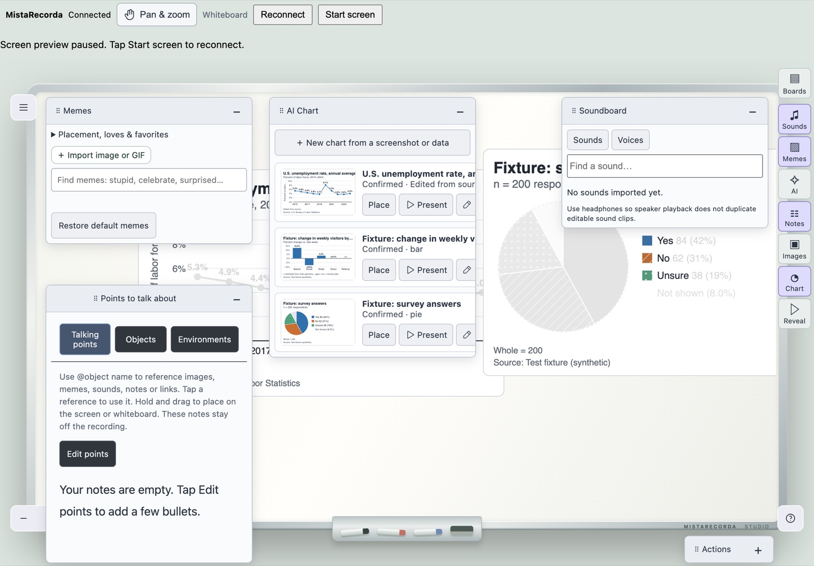
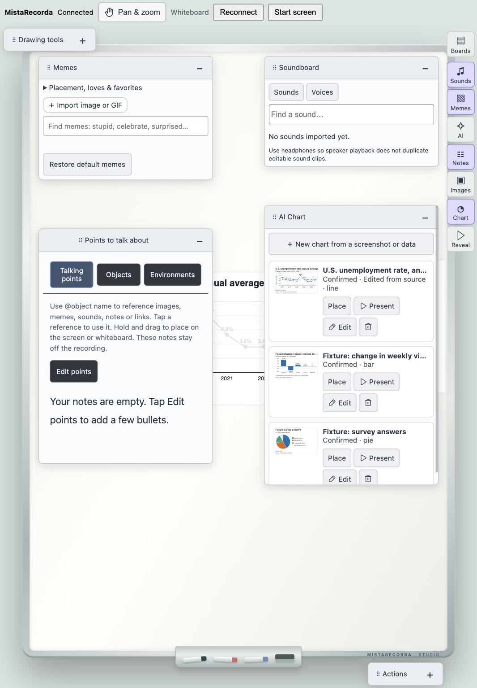

# AI charts

Turn a chart or statistic from a webpage into an editable, correctly labeled chart, then reveal it step by step on the whiteboard or over your screen. The reveal controls stay on the iPad; the audience and the recording see only the chart.

## Make a chart

1. On the iPad, tap **Chart** in the side launcher (or **Chart** in the actions bar on the Mac).
2. Tap **New chart** and choose **Capture Mac screen**, **Upload screenshot** (PNG, JPEG, WebP) or a standby image. You can also tap **Type the numbers** to start without a screenshot.
3. Drag across the screenshot to crop one chart, including its title, axes, legend and source line. Optionally add the source link, publisher, date and date range.
4. Tap **Analyze chart**. Only the cropped image is sent to your OpenAI account (one request, `gpt-6-astra`, structured output). Nothing is uploaded when you open the panel or take a screenshot. You can cancel while it reads. Without an API key, choose **Enter values manually**; the screenshot stays beside the table for reference.

## Review and correct

The original screenshot is shown next to the editable chart. Every value has a confidence:

- **Printed** — read from a label in the source.
- **≈ Estimated** — measured from the chart geometry. Shown with ≈ on the chart and disclosed in its footnote.
- **Unreadable** — left empty. Missing values are shown as gaps or “n/a”, never as zero.

Fix labels, units and values in the **Data** table, or drag a point or bar end in the preview (it snaps to a sensible step and shows the value; arrow keys work too). Undo/redo and **Reset to source** are available. Once any value, label, unit or scale differs from what was extracted, the chart is marked **Edited from source** and the original values are kept.

A draft cannot be shown on screen until you tap **Confirm data**. Confirmation is blocked by statistical errors, for example a pie with negative or missing slices, slices that add up to more than the stated whole, values outside a fixed axis range, or a log scale with zero values.

### Chart rules

- **Line** for change over time. Turn on date spacing so 2000, 2001 and 2010 are spaced by real time.
- **Bar** (vertical or horizontal) for category comparisons. Bars start at zero; a different start is drawn with an axis break and disclosed (“Axis starts at 40”).
- **Pie / donut** only for one nonnegative series that is part of a whole. The whole is explicit: either the sum of the slices or a known total (e.g. 200 respondents). A smaller sum shows the rest as “Not shown”; percentages are never rescaled silently.
- **Statistic card** for one labeled number.
- Several series are supported for line and bar with a legend, line dashes, marker shapes and bar patterns, so colors are not the only cue. Changing the type never drops a series; a pie with several series is an error to fix.
- Log scale is supported and disclosed. The source’s axis notes (“starts at 40”) are kept as a footnote.

## Place and present

Tap **Place**, then tap the canvas. Charts are placed as **shadow objects**: the iPad shows the finished chart at 50% so you know it before presenting; the Mac overlay and recording do not show it. Screen and whiteboard (and each saved whiteboard tab) keep their own charts.

Selecting a chart opens its reveal controls directly below it:

- **Show on screen** makes it visible. The audience version starts with the title, axes and labels only.
- **Next / Previous** reveal one point, bar or slice at a time. Quick taps queue steps.
- **Play / Pause** reveal continuously; **Rewind** and **Show all** jump to either end.
- The **slider** scrubs forwards or backwards. A Pencil or finger that lands on the slider scrubs even in Draw mode; strokes that start anywhere else draw normally, including over the chart.

While a chart is partly revealed, the iPad shows the remaining data as a faint gray ghost. This look-ahead is iPad-only. The floating **Present chart** panel (side launcher → **Reveal**) offers the same controls plus play speed for any chart.

Axis ranges stay fixed while revealing. Pausing a recording also pauses every playing chart, so the take resumes on the same frame.

## Objects, notes, AI mic and environments

- Charts appear in **Points to talk about → Objects** with a chart icon and thumbnail; drag or tap to place (as a shadow), reference them in notes with `@`, and use the gear to open the chart editor.
- AI mic suggestions for charts and figures offer **Create editable chart**. With a verified image, it opens the crop step with the source link and publisher filled in. Otherwise it opens the source in Chrome and asks you to use **Capture Mac screen**.
- Saved environments include charts, their original values and source screenshots. Older environments without charts still load. Charts work offline and remain editable without an API key once extracted.

## Agents (MCP)

The local, authenticated drawing MCP server adds `chart_list`, `chart_create`, `chart_update`, `chart_place` and `chart_present`. Agent-created or agent-edited charts are drafts until you confirm them on the iPad; `chart_place` defaults to a shadow; showing or playing a chart through MCP requires a confirmed chart.

## How it works

- Chart documents (versioned, with stable IDs, original and edited data, provenance, per-value confidence, axis/unit settings, style and reveal settings) are stored on the Mac in `drawing-board/charts/`. Source screenshots are stored beside them, not in the board, so slider movements never resend images.
- A placed chart is an invisible, selectable rectangle that references the chart ID. Excalidraw handles selection, moving, resizing, grouping and shadows; resizing never changes data.
- One deterministic SVG renderer draws the chart from its data on the iPad, the Mac overlay (which the recorder captures), the editor preview and thumbnails. It draws beneath the ink layer.
- Reveal uses a logical clock (`position`, `target`, `anchorAt`, `msPerStep`, `seq`) owned by the Mac. Every surface computes the same frame from it; stale events are ignored by sequence number, and a reconnect receives the current state.

## Validation — 2026-10-15

**Automated:** 1,334 tests across 168 files pass, along with TypeScript, Biome lint on the changed files, and the production Vite build. New chart coverage includes:

- Extraction schema and the strict request shape, plus ragged, multi-chart and impossible output. Untrusted text is sanitized and SVG output escaped.
- Missing, zero, negative, percentage, decimal, large and date values; pie totals; log and truncated axes.
- Drag↔table consistency, undo/redo and edited-from-source tracking.
- The deterministic reveal: play, pause, resume, backward scrubbing, queued steps, stale events and pause on recording pause.
- Draft and reveal guards, including group reveal. Clean-render exclusion of shadows.
- Environment round-trip, old environments, and charts on inactive whiteboard tabs.
- Invalid key, unavailable model, cancellation, late responses, and MCP tool registration.

**Simulated playtest (not a physical iPad):** an Electron harness ran the real companion server, board, chart and presenter stores and the shared chart request handlers, with a stand-in OpenAI client returning scripted extractions. It opened the iPad web app at iPad sizes (1180×820 landscape; 820×1180 portrait by device emulation) with pen-type pointer events, and the real clean board surface.

- Line chart, from a capture of a known screenshot: crop, analyze, correct a misread label (“2O19”) and an estimated value, confirm, place as a shadow, then reveal step by step.
- Play, pause and scrub backwards. Pausing the recording froze the reveal; switching screen/whiteboard and reloading the iPad kept the same frame.
- Edited a point by dragging and applied it.
- Annotated over the chart with the pen. Pen-scrubbed the slider in Draw mode without inking. Pen-panned in Pan & Zoom without inking.
- Repeated with a bar chart on the screen scene (negative, zero and missing values) and a pie with an explicit whole of 200.

The surface was captured at 10 fps and encoded to H.264 with ffmpeg. The decoded frames show the reveal, gaps and ink, with no slider, menu, editor or placement controls.

**Not established yet:**

- Physical iPad Safari and Apple Pencil latency, palm rejection and pressure.
- The native macOS recorder (ScreenCaptureKit) and editor export with charts, including a window-only recording; the harness captured the surface window directly.
- A live OpenAI extraction: no key was used, so model behaviour on real screenshots is untested.
- The **Create editable chart** button on real AI mic results, and the MCP tools against a running app (both covered by unit tests only).
- Reveal playback state is transient: after the Mac app restarts, charts start again from the title and axes.
