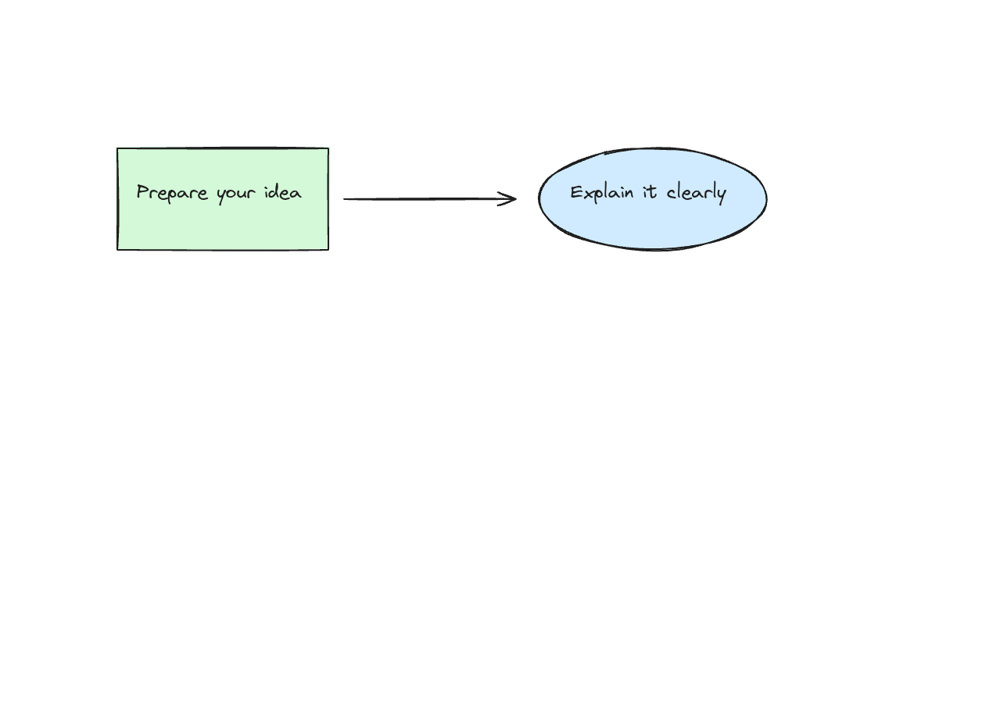
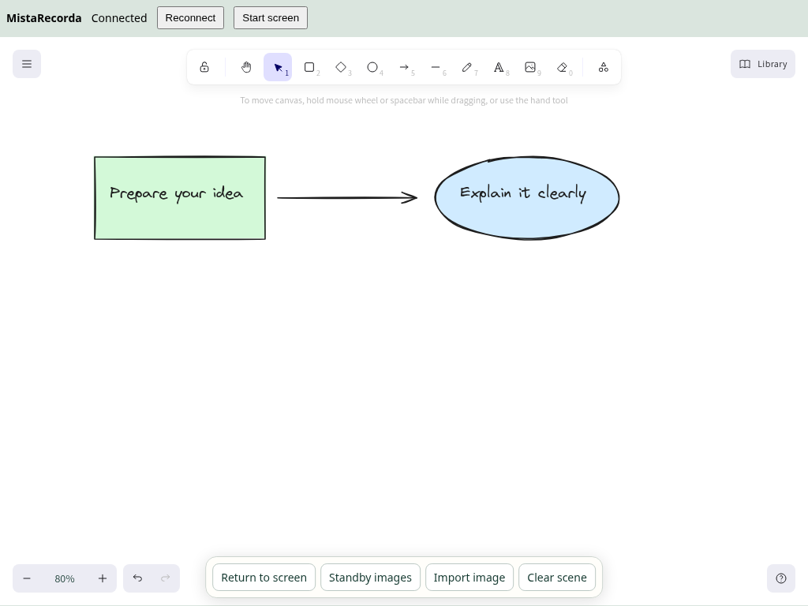
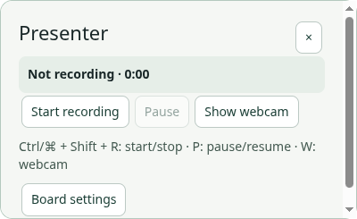

# Drawing board, iPad and Codex

MistaRecorda embeds the [Excalidraw](https://github.com/excalidraw/excalidraw) editor for editable shapes, arrows, handwriting, text, images and reusable groups. USB pairing is deferred; this version uses your local Wi-Fi network.

## Start on your computer

1. Open **Board** on the recorder. Choose the display you will record and enable the drawing overlay **before** recording. Select that same full display in the recorder's source picker.
2. Choose **Draw on computer** for desktop editing, or connect your iPad below. Select an arrow, shape, text or freehand tool from the Excalidraw toolbar. Click **Done drawing** to return mouse control to your desktop.
3. To deploy the whiteboard, move your pointer to the selected display's far-left edge and click the narrow board handle. The framed board swings over the screen. **Put board away** swings it back off the left edge. **⌘/Ctrl + Shift + B** toggles it directly. Hovering alone only reveals the handle. Returning to the screen restores your transparent annotation scene. The two scenes retain their contents independently.
4. Pinch with two fingers on the board to pan/zoom, or use its zoom controls. Desktop navigation changes the shared drawing viewport. On a trackpad, pinch zooms and two-finger scrolling pans. iPad navigation magnifies its own screen preview and ink together without moving the recorded annotations or changing the desktop application's zoom.
5. Use **Recording shows** to choose screen plus drawings, screen only, or the opaque board. The choice is visible immediately. Drawings persist when hidden and across app restarts. The overlay starts disabled after reopening the app.

Use **Clear scene** only when you want to remove that scene's drawings and image tray. Named saved scenes remain available. **Save scene** stores the current scene under the entered name; saving the same name replaces it. **Browse scenes** loads a prepared scene in place of the active scene after confirmation.

The clean surface contains the drawing without editor toolbars. This screenshot is from the Linux desktop playtest, not a native Mac/Windows recording.

## Connect an iPad

1. Put both devices on the same trusted Wi-Fi network. In **Drawing studio → iPad**, click **Show pairing QR**. Choose your Wi-Fi address if several interfaces appear.
2. Scan with the iPad camera and open the page in Safari. The QR expires in five minutes; generate another if necessary.
3. Keep the page open. Click **Approve** for the device on your computer. Then tap **Start screen** on the iPad. The computer streams its selected display without audio; the iPad does not need microphone or camera access.
4. Tap **Pan & zoom** to turn on the highlighted **Draw** button. It enables transparent screen annotation on the Mac; do this before starting a recording. Draw with a finger or Apple Pencil, or choose arrows and circles. Tap **Draw** again for navigation. Pinch/pan magnifies the iPad preview and ink together, leaving recorded annotation positions unchanged. **Fit screen** restores the full display.
5. The iPad follows the Mac: hiding the whiteboard returns to the live screen. **Open whiteboard** deploys it on the Mac without showing desktop editing tools. **Clear scene** removes the current scene's drawings.
6. For text, choose the Text tool and tap a position. Type in the private bubble, then tap **Done** to publish it to the Mac and recording. **Cancel** discards the draft. The keyboard layout is controlled by iPadOS; the app cannot force a floating keyboard to become full-size.
7. **Reconnect** resumes an approved session in the same browser tab. Tap **Start screen** again after a connection failure or display change. Restarting MistaRecorda requires a fresh QR code and pairing approval. **Disconnect** revokes a device; **Stop sharing** closes all companion connections.

The initial page and drawing synchronization use local HTTP/WebSocket, so use a trusted private network. WebRTC carries the screen stream when available. If the network blocks a direct WebRTC connection, an automatic lower-frame-rate JPEG preview obtains fresh display images through the approved local WebSocket connection. A stalled preview requests this fallback and is hidden if no new frames arrive; tap **Start screen** to retry. This fallback is also unencrypted on local HTTP. Guest Wi-Fi isolation, VPNs, firewalls or denied local-network access can prevent connection. Allow MistaRecorda on your private network. Pairing approval is required even with the QR link; do not share the link publicly. There is no remote Internet relay or USB companion app in this version.

The browser companion at 1024×768. Physical iPad/Pencil testing remains separate from this browser playtest.

## Keep assets ready

Paste a screenshot using your platform's paste command, or choose **Import image** for PNG, JPEG or WebP (up to 12 MB). Transparent PNG backgrounds are preserved. **Standby images** holds imported images for repeated placement. Select related shapes and use Excalidraw's Library to keep reusable arrows or grouped drawings. The library is shared with connected devices and saved with the board.

Undo/redo belongs to the active editor. Work from one editing device at a time: conflicting edits show an error instead of silently replacing newer work. Stop drawing before saving/loading a scene or switching tools from another device.

## Recording controls

Recorder menus now hide before recording starts. **⌘/Ctrl + Shift + H** shows or hides the recorder toolbar. New native Mac capture excludes the entire control app, including panels opened during a take. See the [current Capture studio guide](capture-studio.md); screenshots below show the earlier interface.

Click **Compact controls** for a small presenter window showing recording, paused or idle state and elapsed time. **Board settings** expands it again. It provides Start/Stop, Pause/Resume and Show/Hide webcam buttons. Keyboard shortcuts are **Ctrl/⌘ + Shift + R**, **Ctrl/⌘ + Shift + P**, and **Ctrl/⌘ + Shift + W** respectively. Other applications may reserve these shortcuts; the buttons remain available.

Native macOS capture filters out MistaRecorda's presenter/editor windows; Windows uses capture exclusion for those windows. The separate clean drawing surface is included. Board recording is supported on macOS and Windows; Linux can preview/edit the board but requires the overlay disabled to record. Use a full display capture with the board enabled; individual-window capture cannot contain a separate overlay. In board mode the webcam is included in the clean surface, so its shown/hidden state is recorded into the video rather than a separately editable webcam track. The normal recorder retains its existing webcam workflow when the drawing overlay is disabled.

Make a short sample recording on your computer before a tutorial to confirm permissions, display selection, webcam and capture exclusion. Native capture and Apple Pencil behavior require real target-device testing; a Linux cloud desktop cannot validate them.

## Let Codex prepare diagrams

1. Open **Drawing studio → Setup → Codex / MCP → Enable MCP drawing tools**. Copy the configuration shown there into your Codex MCP configuration. It uses a localhost HTTP URL and `bearer_token_env_var = "MISTARECORDA_MCP_TOKEN"`.
2. Set that environment variable in the environment that starts Codex to the copied session token. Keep the token private. Restart/reconnect Codex as required by your client. The URL and token change when the server/app restarts.
3. Ask: “Read MistaRecorda's drawing guide, prepare an editable diagram explaining [topic], inspect it, and save it as [scene name].” The server advertises a drawing guide, a prepare-tutorial prompt and tools to inspect, draw, update, delete, frame, save/load and screenshot the board.
4. For an additional reusable Codex skill, copy [the `mistarecorda-board` folder](skills/mistarecorda-board/SKILL.md) into a skill directory supported by your Codex installation. The server's built-in instructions work even without installing this file.

Codex running on the same computer can reach this server directly. A hosted/cloud Codex session requires a separately configured authenticated bridge to your computer; enabling MCP does not create one. Do not expose the unauthenticated companion page or your MCP token publicly.

To prepare a board from a YouTube tutorial, give Codex an accessible transcript and relevant frames, or authorized tools that can obtain them. The drawing server itself does not watch or download YouTube. Codex can turn that source material into diagrams **before** you record, and save multiple scenes for your tutorial.

For the exact checks performed and remaining device checks, see [Drawing board validation](drawing-board-validation.md).
