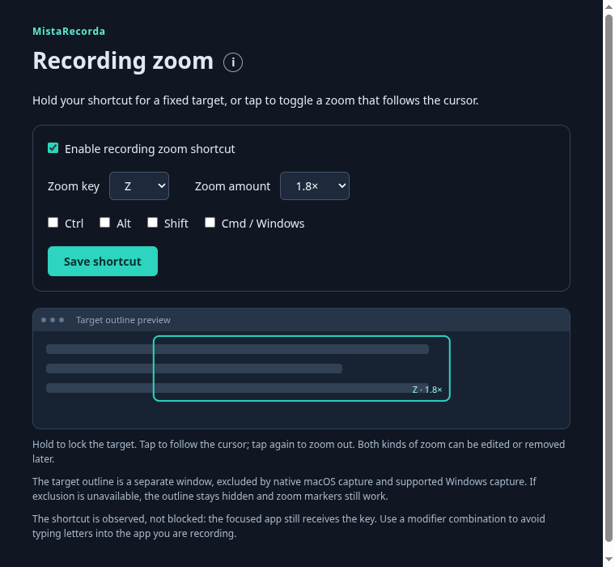
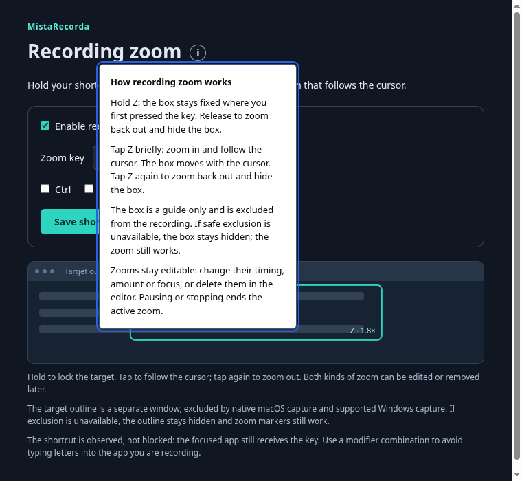
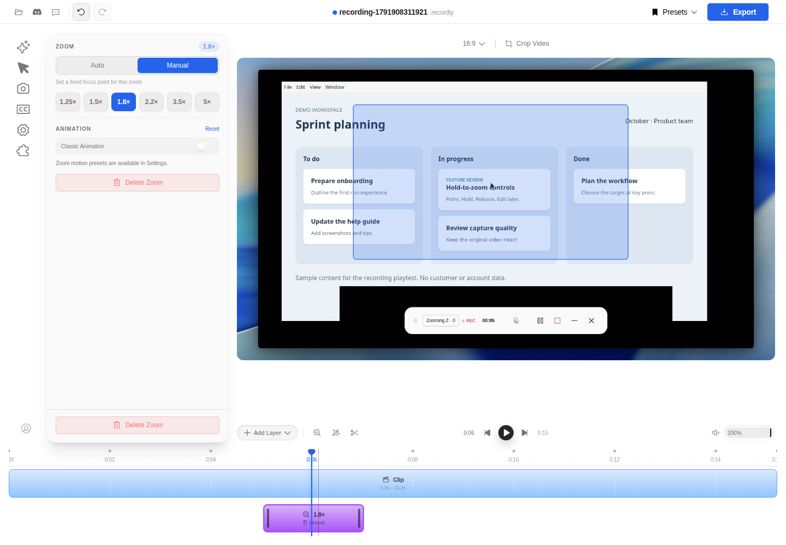
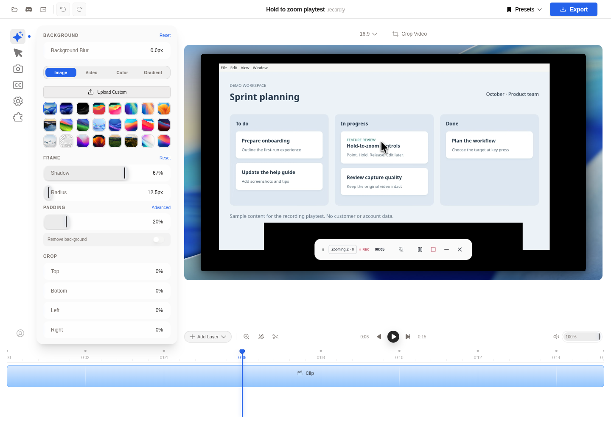

# Hold or tap to zoom

Hold a configurable shortcut for a fixed zoom, or tap it to toggle a zoom that follows the cursor. The original video stays at its original framing. Zoom timing, focus and magnification are applied in the editor and can be changed or removed later.

## Set up the shortcut

1. Click **Zoom Z** on the recorder toolbar to open **Recording zoom**.
2. Leave **Enable recording zoom shortcut** enabled. Choose a letter A–Z or F1–F12, optional Ctrl/Alt/Shift/Cmd/Windows modifiers, and a zoom amount.
3. Click the **i** beside the title for an explanation of both gestures and the excluded target box. Click **Save shortcut**. Settings persist across restarts. Stop an active recording before changing them.

The default is **Z**, with no modifiers, at **1.8×**. The focused application also receives the shortcut, so choose a modifier combination that does not conflict with the application you are recording. On Mac, grant Accessibility and Input Monitoring permissions if the toolbar reports that global keyboard input is unavailable.

## Record a zoom

1. Select the screen or application window and start recording normally.
2. Move the cursor over the area to highlight, then hold **Z** (or your saved shortcut).
3. The target locks at the cursor position when the key goes down. Moving the cursor while holding does not move the target. Near an edge, the target is kept inside the captured area.
4. Release a held key to end the fixed zoom and hide the box. Hold again to create another interval.
5. To follow the cursor instead, tap **Z** briefly and release (under 250 ms). The zoom stays on and the target box follows the cursor. Tap **Z** again to zoom out and hide the box.
6. Stop recording and open the editor. Holds appear as **Manual** zooms; tapped intervals appear as **Auto** zooms and follow the recorded cursor movement. Both can be edited or deleted.

The toolbar shows **Zooming** for a fixed hold, **Following** for a latched cursor-follow zoom, and the number of completed zooms. Pausing or stopping ends either mode and hides the box. After a pause, release and press the key again to begin a new zoom; paused time is not included.

### The target outline

When capture exclusion is supported, a lightweight teal outline shows the fixed target during a hold, or moves with the cursor while a tapped zoom is active. It is a separate, click-through window. macOS native capture explicitly excludes this window through ScreenCaptureKit; Windows 10 version 2004/build 19041 and later uses capture exclusion. The outline stays hidden if the application cannot establish a supported exclusion path, including Linux and macOS browser fallback. Zoom markers still work in those cases.

The blue rectangle in the editor screenshot below is the editor's focus control. It is not burned into the source video or exported frames. The settings window shows an illustrative outline preview, even on platforms where the live outline is hidden.

## Change or remove a zoom

Select the purple zoom interval in the timeline:

- **Timing:** drag the interval left or right. Drag its end handles to change its duration.
- **Magnification:** choose a value from 1.25× to 5× in the Zoom panel.
- **Target:** use **Auto** to follow the recorded cursor. For a fixed focus, select **Manual**, pause playback, then click or drag in the video preview.
- **Remove:** click **Delete Zoom**. Use Undo if needed.

Save the `.recordly` project to retain your edits. Once a project has been saved, subsequent edits autosave. Reopen that project to continue: its saved zooms take precedence over the initial recording markers, including when you removed every zoom. Reopening the original raw recording as a new project can import the original markers again.

Choose **Export** when ready. Export uses the current editor timeline. Keep the original recording and its sidecars together; the initial zoom markers are stored in `<recording>.zooms.json`, separately from the video.

## Voice processing and computer sounds

Voice conversion remains a separate manual action. If exactly one voice is favorited, it is selected on startup. Record with microphone enabled, stop, then click **Process voice**. Only isolated microphone audio is sent to ElevenLabs or receives voice effects; computer audio remains separate and unprocessed. See the [Voice Change guide](voice-change.md) for API setup, presets, preview and export.

## Verification

Linux cloud playtesting used a real Electron recording of a sample task board and a two-second global Z hold, including cursor movement while held. The saved marker retained the initial target and the measured hold interval. The editor imported it as Manual. UI checks changed 1.8× to 2.2×, moved the focus point, moved the interval, extended its end, deleted it, and reopened the saved project with no zoom reappearing. The original recording's SHA-256 remained unchanged. Screenshots above come from that running app; Linux does not exclude the recorder toolbar itself from display captures.

The tap/hold follow-up was also playtested in the running Electron app: a 1.6-second hold ended on release and imported as Manual; a brief tap latched Following across cursor movement for six seconds, and the next tap stopped it. Both intervals appeared together in the editor with their respective modes. Unit tests cover the 250 ms boundary, repeat and duplicate key events, modifiers, pause/resume, stopping, moving versus fixed target coordinates, and preserving Auto mode in sidecars. The i bubble was opened and its screenshot refreshed. Live outline movement/exclusion on Mac and Windows still requires native testing.

Automated verification: 1,056 tests in 114 files, TypeScript, locale consistency and Biome lint passed (21 existing lint warnings). Production renderer/Electron bundles and the Electron main-process smoke check passed. The API readiness check used a read-only ElevenLabs request; no real voice conversion or audio upload was needed.

The additional full-video export smoke check did not pass in this headless host: the modern exporter selected WebGPU and failed to create its rendering resources; the compatibility smoke run did not complete. Editor playback and editing were verified, but successful full-video export is not claimed by this playtest.

Mac and Windows native capture, overlay exclusion, permissions, HiDPI/multiple-monitor behavior and installers require real platform validation. They were not playtested on this Linux host. Before distributing a release on either platform:

1. Build with `npm run build:mac` or `npm run build:win` and grant capture/input permissions.
2. Record both a display and an application window. Hold/release the shortcut, move the cursor, pause/resume, and stop while holding.
3. Verify the target remains fixed, the outline is visible only when exclusion is available, and the raw recording contains neither the target outline nor a black replacement box.
4. Delete the zoom and export. Confirm the target outline is absent in the exported video; repeat with different monitor scaling and a moved application window.
5. Follow the microphone/system-audio acceptance checks in the Voice Change guide.
