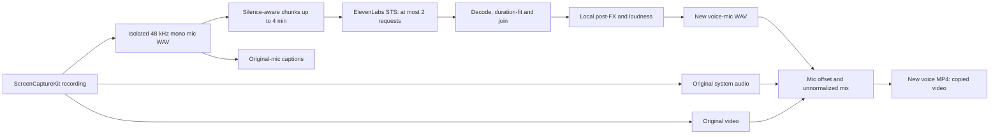

# MistaRecorda Voice Change

MistaRecorda is a personal/internal fork based on Recordly, licensed under AGPLv3. Voice Change processes only the isolated microphone recording after capture. Use voices you own or have permission to use.

## Setup

Install with `npm ci`, start with `npm run dev`, and open **Voice Change** on the recording toolbar. Enter an ElevenLabs key, click **Save key**, then **Test key**. An injected `ELEVENLABS_API_KEY` is also supported by the main process and takes precedence over a stored key. Test key performs only `GET /v1/user`; it does not spend conversion credits or prove a particular voice is accessible. Choose an authorized voice and an ElevenLabs plan with Speech-to-Speech access, accept the mic-only upload notice, and optionally enable automatic conversion.

Stored keys are encrypted with Electron safeStorage in `userData/voice-key.enc`; keys never return through IPC to the renderer. Unavailable keychain encryption and Linux basic_text storage are rejected. An empty saved-key input removes the stored key (an injected key still applies). Never place keys in presets, project files, logs or a synced team folder.

## Pipeline

Silence cuts use concatenation; hard cuts have 50 ms overlap/crossfade so they do not accumulate drift. Every returned chunk is fitted to its input interval before joining; the final WAV is padded/trimmed to the original mic length within 50 ms. The measured mic start delay is applied once in playback/export. System audio is never uploaded or processed with mic effects. Mixing necessarily encodes the combined output audio; “unchanged system audio” means unchanged source file and no voice conversion, gain normalization or post-FX on its signal, not bit-identical compressed packets in the final mix.

Original files are retained. First outputs are `<id>.voice-mic.wav` and `<id>.voice.mp4`; re-runs use unique suffixed names and retain prior outputs. Temporary uploads/responses are under the application temp directory and removed after success, failure or cancellation. The library offers Change voice/Re-run, progress, Cancel, Open and Show in Finder. In the editor, **Mic audio: Original / Changed voice** controls the existing edited-video export pipeline. Captions prefer the original mic and apply its offset.

## Settings

- Automatic conversion defaults off; upload consent is required.
- Models: `eleven_multilingual_sts_v2` (default) or `eleven_english_sts_v2`.
- Stability 0.5, similarity 0.75, style 0, speaker boost on; each numeric voice control ranges from 0 to 1.
- Noise removal defaults on. Output requests PCM 44.1 kHz; unsupported PCM responses fall back to MP3 44.1 kHz/192 kbps.
- Local post-FX defaults: −16 LUFS, no EQ, zero pitch shift. Effects are applied only to converted mic audio. Presets expose EQ and pitch independently of permission to edit the remote voice.

## Troubleshooting and privacy

401: replace/test the key. 402: replenish credits or change plan. 403/404: request voice/workspace access. 422: check mic input and supported settings. 429 and 5xx retry four times with 1/2/4/8-second backoff; Cancel interrupts the wait. Connection failures do not reveal raw request headers or response bodies. A cloud key cannot be verified while its network policy blocks `api.elevenlabs.io`.

No isolated mic: enable microphone recording and verify permissions. MistaRecorda deliberately refuses to upload mixed or system audio as a fallback. For drift, inspect micOffsetMs and follow the delayed-mic and pause/resume Mac tests below. Preserve sidecars beside the video. For keychain failures, unlock the OS keychain and restart the app. Voice conversion uploads microphone audio to ElevenLabs under their account/privacy terms; previews also upload the built-in short sample when explicitly generated. System audio and video stay local.

## Validation status

Linux cloud validation covers strict TypeScript, Biome lint, unit tests, and a real FFmpeg encode/decode/duration test with mocked ElevenLabs responses. The user's later instruction limits live API checks to key readiness; no real conversion is required. Mac capture and packaging remain manual. New UI keys are present in all locale resources with English fallback wording; translation review is welcome.

Final cloud verification: 1,038 tests across 110 files passed; TypeScript, Biome lint (21 existing warnings), locale consistency, Vite production build and Electron main-process smoke checks passed. A running Electron app opened the Voice Change window, round-tripped a preset through typed IPC, rejected a credential field, and exposed only `hasKey` to its renderer. The read-only ElevenLabs `GET /v1/user` key test succeeded. No audio was uploaded during verification.

## Verification on macOS

These checks require a real Mac. They were not run in the Linux cloud environment.

1. Use a Mac with ScreenCaptureKit support (macOS 14+, native microphone APIs vary by OS). Install Xcode command-line tools, CMake and Node; run `npm ci`, `npm run typecheck`, `npm run lint`, `npm test` and `npm run dev`. Confirm the app says MistaRecorda and About credits Recordly.
2. In System Settings → Privacy & Security, grant Screen & System Audio Recording and Microphone permission to the development app. Confirm permission denial produces an actionable message; grant permission and relaunch. Verify `NSMicrophoneUsageDescription` in the generated application bundle.
3. Open Voice Change. Enter your own ElevenLabs key, Test key, choose an authorized voice, accept the mic-only upload notice and enable automatic conversion. Quit/relaunch: hasKey remains true, the field stays empty, and the macOS Keychain securely decrypts the key. Inspect the settings JSON: it must not contain a key.
4. Play a YouTube video with speech/music, enable system audio and mic, and record 30 seconds. Say a distinct phrase and clap at the start, middle and end. Pause/resume once. Stop. Confirm a separate 48 kHz mono PCM `<id>.mic.wav`, system sidecar, and audio metadata exist. Listen to mic WAV: it must contain only the mic input (speaker bleed is acoustic, so use headphones).
5. Watch chunk progress and completion. Open the new `<id>.voice.mp4`. Your voice changes; YouTube system audio remains unprocessed. Check clap sync at start/middle/end (within 50 ms plus recorded capture offset). Compare original source hashes before/after; none should change. Measure converted mic duration using ffprobe.
6. In the editor, switch Mic audio between Original and Changed voice. Preview and export with a zoom, a trim, a speed region and captions. Confirm audio follows the selection and no doubling occurs. Captions must derive from the original mic. Save/reopen the project and verify the recording's selection remains.
7. Record more than 8 minutes, including speech crossing a 4-minute boundary and a silent passage near another boundary. Confirm chunks never exceed 4 minutes, at most two requests run concurrently, and there is no accumulating timing drift or abrupt hard-cut click.
8. Cancel during upload, retry backoff and local FFmpeg processing. Verify the original files survive and the job's temporary directory is removed. Re-run: the previously converted output remains and the new output gets a unique name. Simulate offline/401/402/422/429/5xx with mocks; do not burn credits to manufacture failures.
9. Repeat with microphone disabled (conversion must report no isolated mic), system audio disabled (no doubled original voice), browser microphone fallback, a USB/Bluetooth/Continuity mic with delayed startup, and recording permission interrupted mid-session. Never upload an inline video audio track as a fallback.
10. Run `npm run build:mac`. Launch the resulting personal build, verify its MistaRecorda icon and identifier `com.nikooo11.mistarecorda`, repeat the 30-second test, and confirm bundled FFmpeg/FFprobe and microphone permission usage descriptions work. Signing/distribution are outside this personal/internal workflow.

## Team and preset manual checks

After Phase 10, use two separate ElevenLabs accounts in a multi-seat workspace. Share an owned voice as viewer, then editor, and check permissions. Export/import a preset with non-default values: voice reference, every setting, favorite and embedded preview must survive. Try an inaccessible private voice (ask-owner guidance), a library voice requiring add-to-account, a future schema version, duplicate name, a malformed/oversized file, a preset pack, and a concurrent edit in the synced team folder. Confirm newest updatedAt wins with a .bak and that no export contains credentials. Samples may be included only with explicit consent. A preset is not a downloadable voice model.

## Voice Browser and portable presets

Open Voice Browser and select My Voices, Library, Favorites or Presets. Search the library by text, gender, accent and use case. Stars are local favorites; a public library row separately offers **Add to my ElevenLabs account**, which bookmarks the voice. Remote voice editing is enabled only when ElevenLabs affirmatively reports ownership; category alone never grants permission. Rename/description/labels and extra consented samples update the remote voice, while preset sliders and local effects never modify it.

**Make preset** opens an editor with the voice reference, all STS settings, local loudness/EQ/pitch, tags, creator and favorite state. Enter your name/email so teammates know whom to ask for access. Generate preview explicitly converts a bundled 4.7-second synthetic sample and embeds the resulting WAV. The sample text was authored for MistaRecorda and synthesized locally using eSpeak NG; it is not a real person's voice sample. Save, Save as new, Use, Export, Delete, Share voice with team, and Copy preset to team folder are separate actions. Quick presets in the recording toolbar sort favorites first.

Single exports use strict version-1 `mistarecorda.voice-preset` JSON (`.mpvoice`). Export all makes a ZIP `.mpvoice-pack`. If Include samples and the consent checkbox are both selected, export makes a pack and lets you select sample files (10 maximum, 25 MB each, 50 MB total). Samples are not automatically cloned on import or included without explicit selection. Pack import reads preset JSON without extracting archive paths. Unknown fields (including credentials), invalid settings, future versions and oversized archives are rejected.

Import from the File menu, the browser button, or drag/drop. Embedded previews are available immediately. The app checks voice access, adds accessible public-library references to the account when needed, and asks the named creator to share inaccessible private/workspace voices. Authentication/network failures are shown separately from missing voice access. On duplicate names, supply a new name and Retry. Every voice setting and post-effect survives import unchanged; favorited imports remain favorites.

Local presets live in `userData/presets/*.mpvoice.json`; voice IDs are starred in `userData/favorites.json`. Choose a shared synced folder with **Team presets folder**; use **Copy preset to team folder** to publish a preset there. The app watches preset JSON changes, shows Mine and Team, and resolves matching-ID conflicts by newest `updatedAt`, retaining the replaced file as `.bak`. File writes are serialized and atomic. A folder does not grant ElevenLabs voice access: use **Share voice with team** with email/group and viewer/editor/admin role in a multi-seat workspace. Each teammate supplies their own key.

Browser capture fallback now records cloned microphone and system tracks independently as well as preserving the original recording. The personal fork disables upstream auto-updates to avoid replacing MistaRecorda with a Recordly release. Original optional platform entries in the lockfile are retained so native Mac dependencies remain reproducible.
